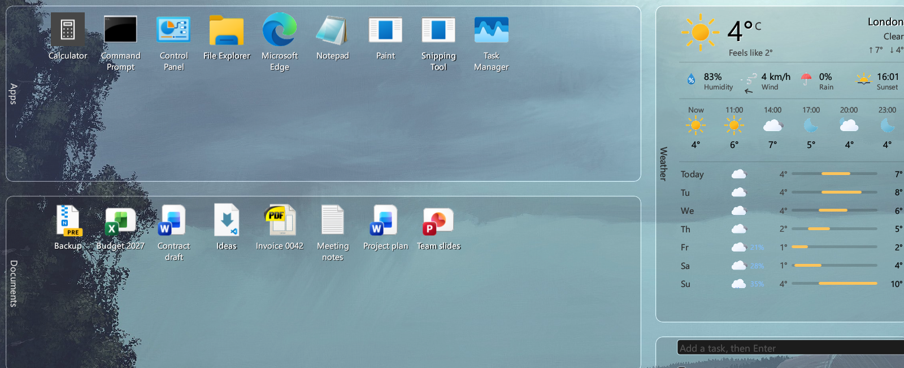
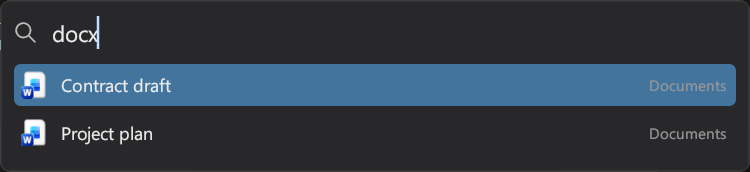
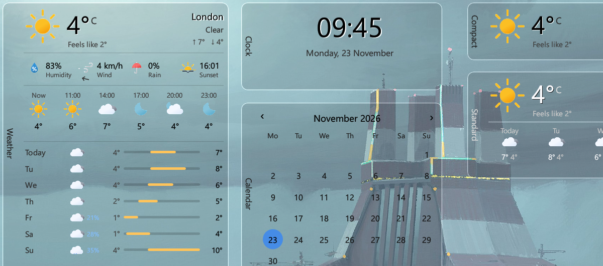
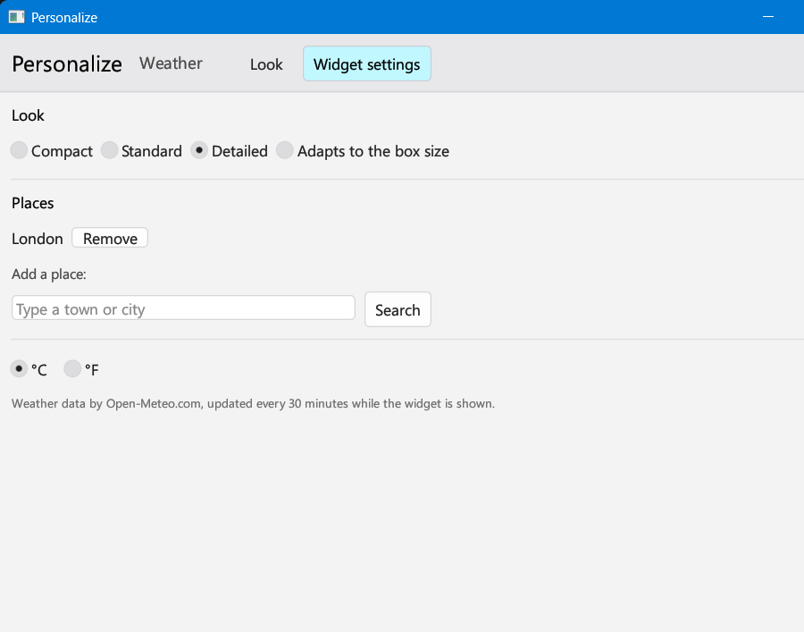
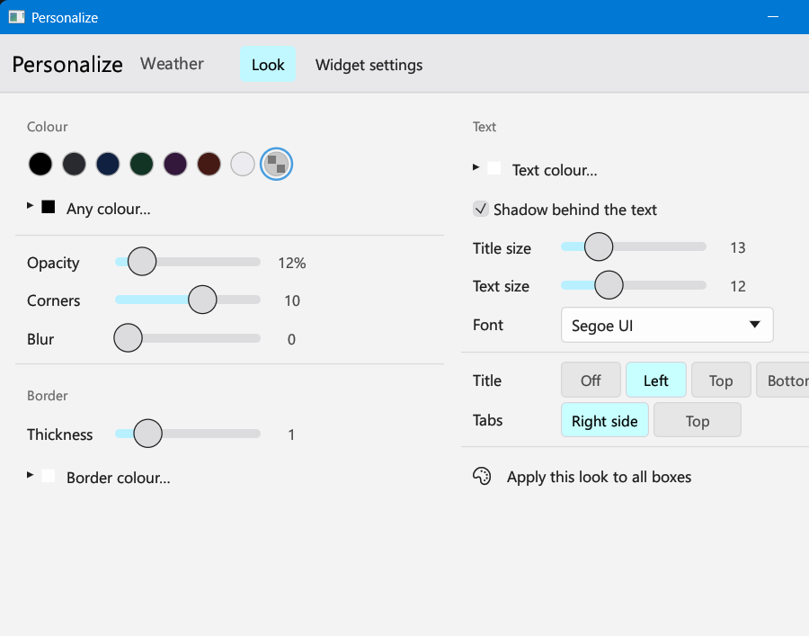
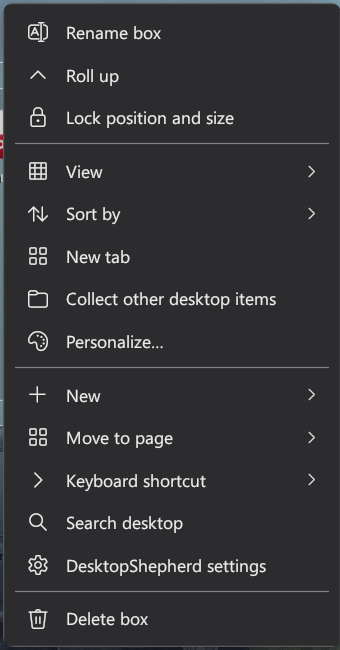
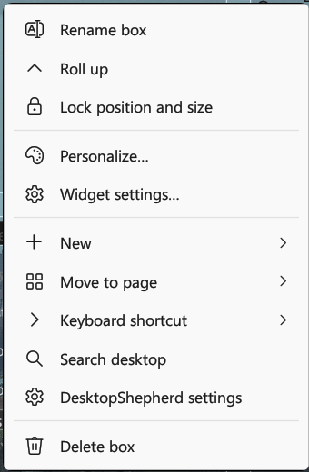
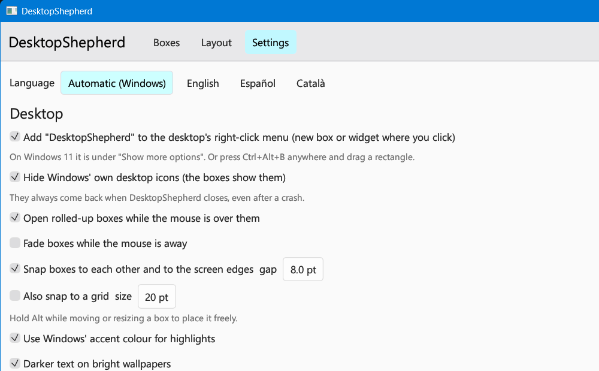
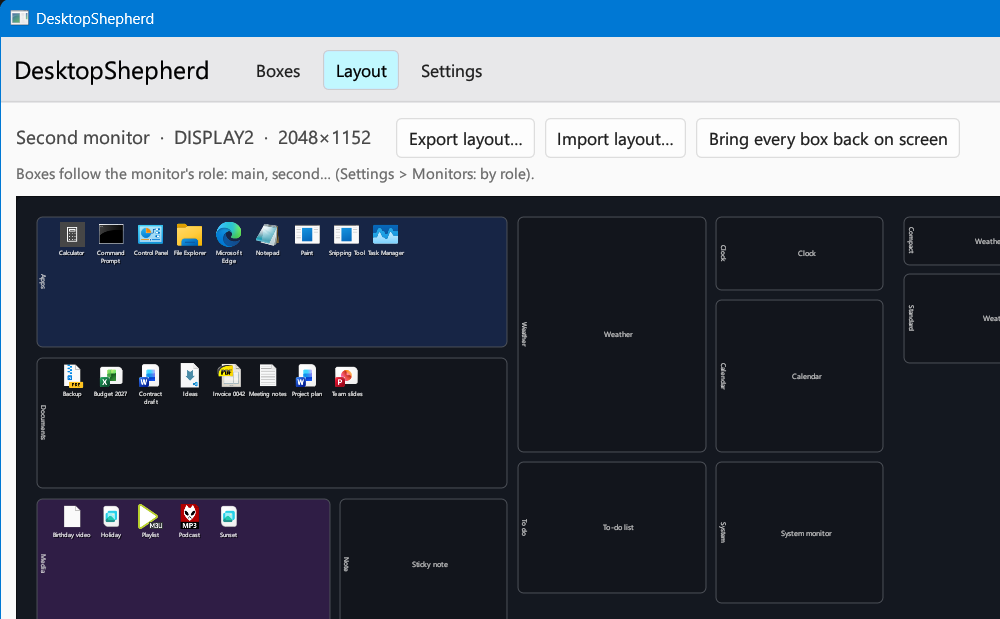

<p align="center"></p>

# DesktopShepherd

**Tidy, frosted-glass boxes for your Windows 11 desktop icons. Light on resources, safe by design.**

[Download the latest release](https://github.com/radioactivetoy/DesktopShepherd/releases/latest)
(Setup or Portable) - current version: 1.0.0-rc.2



*Translucent boxes hold your icons and widgets, and sit right on the desktop.*

Wallpaper in the screenshots: artwork by Simon Stålenhag (https://www.simonstalenhag.se/).

## What it is

DesktopShepherd puts translucent, frosted-glass boxes on your Windows 11 desktop. Boxes hold your
desktop files, folders and shortcuts, or small widgets such as a clock, weather or a calendar.
The boxes sit behind your windows, like the desktop itself, and the program uses very little
memory and almost no processor time while you work. Its behaviour follows the idea of the
commercial desktop organizers, but it is an original program written in Rust.

## Principles

These rules decide what goes in and what stays out.

- **Stability first.** DesktopShepherd never hooks into or injects code into Explorer, so it
  cannot freeze it. Windows' own desktop icons are hidden while it runs, and a tiny supervisor
  process always gives them back, even after a crash. If the app crashes it is restarted
  (waiting a bit longer after each failure in a row). Your layout is saved atomically, with
  dated backups.
- **Performance.** About 0 % CPU when idle, and no continuous redrawing: a box is redrawn only
  when something changes. Measured on a Windows 11 PC: the main process uses about 99 MB of
  memory (113 MB with drop shadow and raised look on all boxes) and about 0.02 % CPU at idle; the
  supervisor uses about 2 MB.
- **Privacy.** No telemetry, ever. Online features only work when you turn them on or add them:
  weather (from Open-Meteo), agenda calendar links, and an optional once-a-day check for new
  versions. They use Windows' own WinHTTP, run in the background, and send nothing about you.
- **Native look.** Real Windows glass (the same effect as the taskbar and Start menu), Segoe UI
  and Fluent icons, your Windows accent colour, light and dark menus.
- **No web engine, no Electron.** It is Rust with its own small DirectX 11 renderer and egui for
  the interface. If your graphics card is weak (or over Remote Desktop) it falls back to
  software DirectX (WARP), and if glass cannot start at all, to plain windows with a solid dark
  background.

## Features

### Boxes

- Title on the left, top, bottom, or off; tabs inside a box; lock; rename; delete.
- Roll up a box to its title bar, and open it again just by hovering.
- Pages of boxes (dots show the page; Ctrl+Alt+PageDown / PageUp or the tray icon switch pages).
- When icons do not fit: scroll, or "pages with dots".
- **Folder boxes** show the live contents of a folder, for example Downloads.
- **Auto-sort box** with your own category rules: by file type, name pattern (`*invoice*`) or age.
- **Snapping** to other boxes and screen edges, with an adjustable gap, and an optional grid.
  Hold Alt to place a box freely.
- **Draw a box anywhere:** press Ctrl+Alt+B, drag a rectangle, choose Box, Folder box or a widget.
  Or use "New" in the desktop right-click menu: the box appears where you clicked.
- A keyboard shortcut per box (Ctrl+Alt+F2 to F10) brings it into view; press again to roll it
  up or down.
- Hide or show all boxes with one shortcut (default Ctrl+Alt+D) or from the tray menu.
- Multi-monitor: a box follows a monitor's role (main, second...) or stays on one fixed
  monitor. Positions are remembered separately for each monitor setup (for example laptop alone
  or docked).
- Optional: boxes fade while the mouse is away.
- Optional: each Windows virtual desktop shows its own page of boxes.

### Icons

- Select with a click, Ctrl/Shift or a rubber band; drag icons between boxes.
- Explorer-style Ctrl+C / Ctrl+X / Ctrl+V. Files copied anywhere (also from Explorer) paste into
  the box under the mouse.
- F2 renames in place, Delete sends to the Recycle Bin, Enter opens, arrow keys move the selection.
- Windows' own right-click menu ("More options" shows the full one with 7-Zip, Send to, Open
  with...). It runs in a short-lived helper process, never inside Explorer.
- Type to jump: with the desktop in front, type a letter to jump to the next icon starting with
  it. Alternatively typing starts a quick search, or does nothing (Settings).
- Icon names wrap at word boundaries.

### Quick search

Press **Ctrl+Shift+Space** (changeable, or off). A search box appears at the top of the main
monitor and finds desktop items by name, file type, or letters in order ("vsc" finds Visual
Studio Code). Optionally it also lists Start menu programs. Each result shows which box the item is
in. **Enter** opens it, **Ctrl+Enter** opens its folder, **Esc** closes.

<p>

</p>

### Widgets

Create a widget from a box's "New" menu, or draw one anywhere.

| Widget | What it does |
|---|---|
| Clock | Time and date (24-hour option) |
| Sticky note | Free text, copy and paste work |
| Drawing pad | Quick sketches |
| System monitor | CPU, memory and drive space |
| Laptop status | Battery, Wi-Fi and Bluetooth |
| Now playing | Current track with cover, play/pause/next/previous and progress; several players switch with dots |
| Weather | Several places (dots to switch), Meteocons icons, feels-like, humidity, wind, chance of rain, sunrise/sunset, UV, hourly strip and 7 days. Looks: Compact, Standard, Detailed or adapts to the box size |
| Timer | Countdown / Pomodoro timer |
| Calendar | Month view, week start option |
| To-do list | Simple checklist |
| Agenda | Online calendars from iCal (.ics) links such as Google or Outlook, including repeating events. Month, week and list views, with event details |
| Picture frame | PNG or JPEG, fit or fill |
| Search box | A quick search of your desktop, right in a box |

Widgets stay clean: no buttons or menus on them. Their options are in the box's right-click
menu under **"Widget settings..."**.

<p>

</p>
<p>

</p>

### Look and personalization

- Per box: colour with opacity, blur, rounded corners, border thickness and colour, text colour
  and shadow, fonts, title and text size, icon size and spacing, names under icons on or off.
- "Apply this look to all boxes" in one click.
- Follows the Windows accent colour for highlights.
- Menus and settings: Light, Dark, or like Windows.
- Adaptive text (optional, on by default): text turns dark by itself over bright parts of the
  wallpaper. It also works with wallpaper slideshows.

<p>

</p>
<p>


</p>

### Settings and safety net

- A Layout page shows every monitor with its boxes, and can export or import your layout, or
  bring boxes back onto the screen.
- Deleted a box by mistake? Undo it (a note appears for a few seconds; also in the tray and in
  Settings).
- Automatic layout backups you can restore from Settings.
- Optional: keep your layout in sync between PCs through OneDrive.
- Optional: check for new versions (once a day).
- Start with Windows.
- Languages: English, Spanish, Catalan, French, German, Italian and Portuguese (follows Windows by default). Native speakers: if a translation reads badly, please suggest better wording in a GitHub issue.

<p>

</p>
<p>

</p>

## Install

Get the latest files from the
[Releases page](https://github.com/radioactivetoy/DesktopShepherd/releases/latest).

- **Setup (.exe):** installs for your user only, no administrator rights needed. It adds a
  Start menu shortcut and an entry in Windows' Installed apps, where you can uninstall it
  (you are asked whether to keep your saved boxes). Running a newer Setup updates it.
- **Portable (.zip):** unzip anywhere and run `DesktopShepherd.exe`. Because of the
  `portable.txt` file next to it, all settings live in a `data` folder beside the program.
  Delete `portable.txt` to use your user profile instead.

Requires **Windows 11**. Other versions have not been tested.

The program is not code-signed yet, so Windows SmartScreen may say "unknown publisher". Choose
"More info", then "Run anyway".

## Quick start

1. Run it. On the first start your Windows desktop icons are hidden and appear inside boxes.
2. **Right-click a box** for its menu: Personalize, Widget settings, New, rename, delete...
3. To add a box: right-click an empty spot of the desktop, choose "Show more options", then
   **DesktopShepherd > New...**, or press **Ctrl+Alt+B** and draw one.
4. Settings are in the **tray icon** menu (and in the box menu).
5. To quit, use the tray menu: the icons come back right away.

## Where your data lives

`%APPDATA%\DesktopShepherd` holds `layout.json` (your boxes), `backups\` (older copies of the
layout) and `log.txt`. The portable version keeps the same files in its `data` folder.

## Building from source

Short version:

```powershell
cargo build
.\target\debug\desktopshepherd.exe
```

Read [docs/BUILDING.md](docs/BUILDING.md) first. In particular, never run `cargo update`: some
crates are pinned. Releases are built by GitHub Actions on MSVC (`.github/workflows/release.yml`).
Pushing a tag like `v0.2.0` publishes a Release with the Setup and Portable files; tags
containing `beta` or `rc` are marked as pre-releases.

`desktopshepherd.exe --screenshot out.png` draws the settings view off-screen and saves a PNG.

## Project layout (for developers)

| File | Contents |
|---|---|
| `src/main.rs` | start-up, supervisor, panic hook |
| `src/runloop.rs` | the program's own Win32 message loop and hotkeys |
| `src/app.rs` | application state, boxes UI, menus, settings, drag and drop |
| `src/host.rs`, `src/d3d.rs` | DirectX / Windows composition box windows and the renderer |
| `src/desktop.rs` | Win32 helpers: desktop scan, hide/show icons, monitors, z-order |
| `src/widgets.rs` | widget registry (add new widgets here) |
| `src/search.rs`, `src/snap.rs` | quick-search ranking and snapping |
| `src/shellmenu.rs` | Windows' own context menu in a helper process |
| `src/model.rs`, `src/storage.rs` | saved layout and settings, backups |
| `src/install.rs` | built-in installer and uninstaller |
| `src/i18n.rs` | English, Spanish, Catalan, French, German, Italian and Portuguese texts |

More in [docs/ARCHITECTURE.md](docs/ARCHITECTURE.md) (processes, threads, rendering, every
source file) and [docs/STATUS.md](docs/STATUS.md) (measurements, known issues, ideas).

## Credits and licences

- Weather icons: [Meteocons](https://meteocons.com/) by Bas Milius, MIT licence
  (`assets/meteocons/LICENSE`).
- Weather data: [Open-Meteo.com](https://open-meteo.com/).
- User interface: [egui](https://github.com/emilk/egui).
- Wallpaper in the screenshots: artwork by Simon Stålenhag (https://www.simonstalenhag.se/).
- App icon: based on an image generated with Google Gemini, adapted for DesktopShepherd.

## License

DesktopShepherd is free software under the [GNU General Public License v3.0 or later](LICENSE):
you may use, study, share and change it; if you share a changed version, it must stay under the
same licence, with its source code available.
